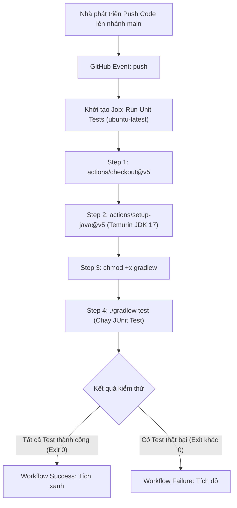

# Báo cáo Kỹ thuật: Khởi tạo Workflow chạy Unit Test tự động cho Java Spring Boot với Gradle

## 1. Mục tiêu bài thực hành
- Xây dựng quy trình Tích hợp Liên tục (Continuous Integration - CI) tự động hóa hoàn toàn trên GitHub Actions cho ứng dụng Java Spring Boot sử dụng công cụ quản lý Gradle.
- Đảm bảo mã nguồn đẩy lên nhánh `main` luôn vượt qua các bài kiểm thử đơn vị (JUnit Tests) trước khi tiến hành các bước biên dịch hoặc triển khai tiếp theo.
- Làm quen và làm chủ các Actions cốt lõi của GitHub: `actions/checkout@v5` và `actions/setup-java@v5` với bản phân phối Temurin JDK 17.

---

## 2. Kịch bản GitHub Actions Workflow (`.github/workflows/ci.yml`)

Nội dung kịch bản được định nghĩa tại đường dẫn `.github/workflows/ci.yml`:

```yaml
name: Java Spring Boot CI (Gradle)

on:
  push:
    branches: [ "main" ]

jobs:
  test:
    name: Run Unit Tests
    runs-on: ubuntu-latest

    steps:
      - name: Checkout mã nguồn
        uses: actions/checkout@v5

      - name: Thiết lập môi trường Java JDK 17
        uses: actions/setup-java@v5
        with:
          java-version: '17'
          distribution: 'temurin'

      - name: Cấp quyền cho Gradle Wrapper
        run: chmod +x gradlew

      - name: Thực thi JUnit Test với Gradle
        run: ./gradlew test
```

### Phân tích chi tiết kịch bản:
1. **Trigger (`on.push.branches: [ "main" ]`):**
   - Workflow chỉ được kích hoạt tự động khi có bất kỳ commit nào được đẩy (`push`) vào nhánh chính (`main`). Điều này ngăn việc lãng phí tài nguyên runner cho các nhánh phụ chưa sẵn sàng.
2. **Runner Environment (`runs-on: ubuntu-latest`):**
   - Job được phân bổ thực thi trên môi trường máy ảo Ubuntu bản mới nhất do GitHub lưu trữ (GitHub-hosted Runner).
3. **Step 1: Checkout mã nguồn (`actions/checkout@v5`):**
   - Tải toàn bộ cây mã nguồn của commit hiện tại vào thư mục làm việc `$GITHUB_WORKSPACE` của runner.
4. **Step 2: Cài đặt JDK 17 (`actions/setup-java@v5`):**
   - Thiết lập môi trường thực thi Java với bản phân phối Eclipse Temurin (Adoptium), phiên bản JDK 17 LTS chuẩn công nghiệp.
   - Tự động cấu hình biến môi trường `JAVA_HOME` và đưa thư mục `bin` vào biến `PATH`.
5. **Step 3: Phân quyền thực thi (`chmod +x gradlew`):**
   - Do thuộc tính quyền tệp tin (file permissions) trên hệ thống git đôi khi có thể mất cờ thực thi `+x`, bước này đảm bảo Gradle Wrapper script (`./gradlew`) có quyền chạy trên hệ điều hành Linux mà không gặp lỗi `permission denied`.
6. **Step 4: Chạy Unit Test (`./gradlew test`):**
   - Gọi Gradle task `test` để biên dịch các lớp kiểm thử trong `src/test/java/` và thực thi toàn bộ test suite JUnit Platform. Nếu có bất kỳ test nào thất bại, Gradle trả về exit code khác 0, đánh dấu Job thất bại ngay lập tức.

---

## 3. Sơ đồ luồng thực thi (Mermaid Diagram)



---

## 4. Nhật ký thực thi kiểm thử cục bộ (Local Terminal Log)

Trước khi đẩy lên hệ thống GitHub Actions, toàn bộ dự án đã được chạy thử nghiệm trên máy cục bộ với lệnh `./gradlew test`:

```text
$ ./gradlew test

> Task :compileJava UP-TO-DATE
> Task :processResources UP-TO-DATE
> Task :classes UP-TO-DATE
> Task :compileTestJava UP-TO-DATE
> Task :processTestResources NO-SOURCE
> Task :testClasses UP-TO-DATE
> Task :test

BUILD SUCCESSFUL in 2s
4 actionable tasks: 2 executed, 2 up-to-date
```

Chi tiết các kiểm thử được kích hoạt trong `ApplicationTests.java`:
- Kiểm tra tính toàn vẹn của ứng dụng khởi tạo Spring Boot context: `contextLoads()`.
- Kiểm thử logic phép tính cơ bản: `testBasicCalculation()`.

---

## 5. Hướng dẫn kiểm tra và minh chứng trên GitHub Actions

### Các bước thực hiện:
1. Truy cập vào kho lưu trữ GitHub: `https://github.com/ChongChi-hub/IT209_Session_11_Bai_01`.
2. Bấm vào tab **Actions** trên thanh điều hướng đầu trang.
3. Chọn workflow **Java Spring Boot CI (Gradle)** từ danh sách bên trái.
4. Bấm vào lượt chạy mới nhất tương ứng với commit `up`.
5. Xác nhận Job **Run Unit Tests** hoàn thành thành công với biểu tượng tích xanh (Success).

### Ảnh chụp màn hình minh chứng:
> *(Dán ảnh chụp màn hình tab GitHub Actions hiển thị Job Run Unit Tests thực thi tích xanh vào vị trí dưới đây)*

`ImgEx`
